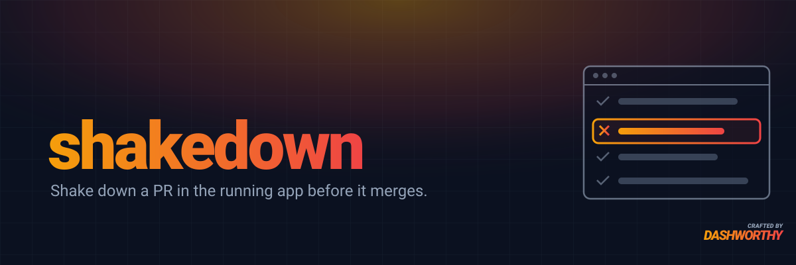

# shakedown



A Claude Code plugin that shakes down a pull request in the running app before it merges.

Code review reads the diff, and the test suite proves what someone thought to test. shakedown
uses the app the way its users do: it maps the change to every page, link and form it reaches,
walks each one in Chrome, and reports what a user would hit. It is **report-only**: it finds and
proves, and never edits app code.

## What it looks for

- Broken or missing behavior, checked against the change's specs and PR description
- Regressions, each one confirmed by repeating its steps on the base branch
- Broken links, navigation and forms (validation, double submits, lost unsaved changes)
- Bad UI: empty, loading and error states, overflow, narrow widths, missing labels and tooltips
- UI inconsistency, including new components or patterns that duplicate ones the app already has
- Confusing behavior: no feedback, dead ends, inconsistent terms, unasked-for state loss
- Console errors, failed or duplicate requests, permissions, keyboard and focus, live updates

## Requirements

- Claude in Chrome, with you signed in to the app you're testing
- [tldraw Desktop](https://github.com/tldraw/tldraw-offline), running, for the screenshot board
- `gh`, authenticated, for the PR comment
- Node 18 or later

## Install

```
/plugin marketplace add dashworthy/shakedown
/plugin install shakedown@shakedown
```

## Use

```
/shakedown:shakedown [PR, branch or diff] [app URL]
```

Both arguments are optional. With no target it shakes down the current branch against its PR's
base. It asks for anything it can't find: where the change is running, how to reach the base
branch's code, which role you're signed in as, and whether it may write data there.

A run goes:

1. **Impact map.** Every page the change reaches, including pages reached only through shared
   components, services or routes.
2. **Plan.** Directly changed pages get every check that applies; pages reached only through
   shared code get a regression smoke.
3. **Walk.** Each flow in Chrome, reading the console and network after every action, with a
   screenshot of every behavior checked, passing or not.
4. **Base.** Each suspected regression repeated on the base branch, so regressions are told
   apart from things that were already broken.
5. **Prove.** A failing browser test for each confirmed bug, in the project's own browser test
   framework, left uncommitted.
6. **Report.** Ticket-style findings, each saying why it's a problem, and a coverage table that
   tells "nothing found" apart from "not checked".

## What you get

- A **tldraw board**: one frame per page, one captioned screenshot per behavior, colored by
  result (pass, finding, already broken, not tested).
- A **PR comment** with the board, the findings, the coverage table and every screenshot. Images
  are committed to a `shakedown-assets` branch in the same repo, so a private repo's images stay
  private.
- **Failing tests** for confirmed bugs, ready to start a fix from.

## Project file

shakedown works out where a project keeps its routes, components, theme, specs and browser tests.
Save those facts in `.claude/shakedown.md` and later runs start from them; the first run offers to
write it. See [`skills/shakedown/references/project.md`](skills/shakedown/references/project.md).

## License

MIT © Andrew Leach
